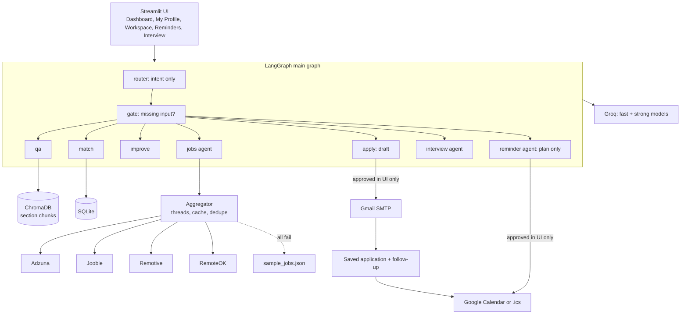

# CareerPilot

A free, GenAI + agentic job-application assistant for India-based jobs. Upload a resume, pick a role and a city, then ask questions, score a job description, find and rank jobs, send an approved application with a calendar follow-up, and practise an adaptive mock interview.

Built with Streamlit, LangChain + LangGraph, Groq (Llama models), ChromaDB, SQLite. Everything runs on free tiers.

## What it does

| | Feature | Type |
|---|---|---|
| 1 | **Resume QA**: answers about your resume, citing the section, saying so when something is not there | RAG |
| 2 | **JD Match**: weighted, explainable score (skills 40, experience 25, education 15, ATS keywords 10, projects 10) | GenAI |
| 3 | **Improve and Generate**: rewrites bullets, drafts a cover letter and recruiter email, never invents facts | GenAI |
| 4 | **Agentic task 1, Job Search and Rank**: plans keywords, queries several job APIs at once, judges the results, refines and searches again (max 2 times), scores and ranks the best | Agent |
| 5 | **Agentic task 2, Apply**: drafts, waits for your approval, then sends the email, saves the application, and adds a Google Calendar follow-up | Agent |
| 6 | **Agentic task 3, Adaptive Mock Interview**: asks 5 questions one at a time, scores each with a rubric, asks one follow-up on a weak answer, saves a report | Agent |
| 7 | **Agentic task 4, Reminders**: reads a job post or email, finds application deadlines, test and interview dates, plans reminders (and a prep block before interviews), and adds them to Google Calendar after you approve | Agent |

## Screens

A navy sidebar switches between five pages:

| Page | What is there |
|---|---|
| **Dashboard** | Application pipeline counts, resume / last match / jobs / reminders cards, upcoming dates, next-step checklist, connection status |
| **My Profile** | Your name, resume upload and text, role, city, remote switch, job sources, **Delete my data**. Click **Save changes** to index a new resume |
| **Workspace** | Chat, Match, Jobs and Apply as sections of one page |
| **Reminders** | The calendar agent: paste text, review, approve |
| **Interview** | The adaptive mock interview |

## Setup (Windows, PowerShell)

```powershell
cd careerpilot
py -m venv .venv
.venv\Scripts\Activate.ps1          # if blocked: Set-ExecutionPolicy -Scope CurrentUser RemoteSigned
pip install -r requirements.txt
copy .env.example .env              # then fill in .env (see below)
streamlit run app.py
```

macOS / Linux: `python3 -m venv .venv && source .venv/bin/activate`, then the same `pip` and `streamlit` commands.

The pins in `requirements.txt` were tested on Python 3.13. If one is not available on your Python version, relax that line to `package>=version`.
The first resume load downloads the local embedding model (about 90 MB). After that it works offline for embeddings.

Check it works without the UI: `python smoke.py`. Run the tests: `pytest`.

## Keys (all free)

Only `GROQ_API_KEY` is needed to get AI answers. Without any job keys the app searches the bundled sample listings and says so on screen.

| Key | Where to get it |
|---|---|
| `GROQ_API_KEY` | Create an account at console.groq.com, then API Keys. Model IDs change: check the Groq console and set `GROQ_MODEL_FAST` / `GROQ_MODEL_STRONG` in `.env` if one stops working. |
| `ADZUNA_APP_ID`, `ADZUNA_APP_KEY` | Register at developer.adzuna.com and create an app. Main India source. |
| `JOOBLE_API_KEY` | Request a key on Jooble's API page (jooble.org/api/about). Approval can take a while; the app works without it. |
| `SMTP_USER`, `SMTP_APP_PASSWORD` | Your Gmail address and an app password. Turn on 2-step verification, then Google Account, Security, App passwords. |
| `GOOGLE_CREDENTIALS_FILE` | Path to `credentials.json` (default: project folder). See below. |

### Google Calendar (optional)

1. Create a project at console.cloud.google.com and enable the **Google Calendar API**.
2. OAuth consent screen: choose External, and add your own Gmail as a **test user**.
3. Credentials, Create credentials, **OAuth client ID**, application type **Desktop app**. Download the JSON and save it as `credentials.json` in the project folder.
4. In the app, open the Apply tab and click **Connect Google Calendar** once. A browser window asks for permission.

CareerPilot asks for one permission only, `calendar.events`, and only ever creates a single follow-up event after you approve. It never edits or deletes other events. The login is stored in `token.json` (git-ignored). **To revoke access:** Google Account, Security, Third-party access, remove CareerPilot, and delete `token.json`.

Without Calendar, you get a downloadable `.ics` file instead.

## Job sources

| Source | Key | Coverage | Notes |
|---|---|---|---|
| Adzuna | yes | India, city level | Main source. Salaries in INR when listed. "Jobs by Adzuna". |
| Jooble | yes | India, city level | Salary text is parsed best-effort. Adapter follows the request shape from Jooble's public examples; its full docs need a key, so verify it once you have one. |
| Remotive | no | Remote | The provider allows about 4 requests per day, so the feed is fetched once a day, cached, and filtered locally. Listings link back to Remotive and name it as the source. Do not republish its jobs elsewhere. |
| RemoteOK | no | Remote | Terms require crediting Remote OK and linking to the listing. The first array item (legal notice) is skipped. Feed cached 24 h. |
| Jobicy | no | Remote | Credit Jobicy and keep the Jobicy link. Optional, off by default. |
| Arbeitnow | no | Mostly Europe | Remote listings only. Optional, off by default. Adapter not verified against docs. |

Rules the app follows: India sources first; remote sources only when you tick **Include remote roles**, and only listings that say India, Worldwide, Anywhere, APAC or Asia are kept; every listing shows its source and original link; responses are cached (6 h for keyed India sources, 24 h for remote ones); one failing or slow source never breaks a search. It does not scrape LinkedIn, Naukri, Indeed or any site that forbids it.

## Architecture



Job agent loop: `plan_keywords -> fetch_jobs -> evaluate_results -> (refine and fetch again, max 2) -> score_and_rank`.
Interview loop: `plan_questions -> ask -> evaluate_answer -> decide (follow-up | next | report)`.
Reminder agent: `extract -> validate -> (read again once if nothing valid) -> plan`, then **you approve**, then events are created.

### Reminders (Google Calendar)

Open the Reminders tab (or type "remind me: interview on 5 Nov at 11 am" in Chat), paste a job post, email or message, and click **Find dates**. The agent finds:

| Found | Calendar entry | Reminders |
|---|---|---|
| Last date to apply | all-day event | 9:00 the day before, and 3 days before |
| Interview or online test | timed event (10:00 IST if no time is given, flagged) | 1 day before and 1 hour before |
| Interview or test | extra "Prepare for..." block the evening before (18:00 IST) | 30 minutes before |
| Follow-up (also created by the Apply tab) | 10:00 IST | 30 minutes before |

You see every planned entry in a review table, untick any you do not want, and click **Approve and add to calendar**. Without a Google connection you get one `.ics` file instead. Reminders that would already have fired are dropped, dates in the past or more than 400 days away are rejected, and duplicates are skipped. The model only reads dates out of text; code validates every date and time, and the calendar is only touched after you approve. Events are inserted only, never edited or deleted.

## Screenshot


## Security and privacy

- **Your data and the AI.** Your resume text and job descriptions are sent to the Groq API to produce answers. Job searches send only a role and a city (never resume text) to the job APIs. SQLite, ChromaDB and tokens stay on your machine. Use sample or non-sensitive data for demos. **Delete my data** in the sidebar wipes the resume, vectors, drafts, applications, interview history and cached resume-derived data.
- **Secrets** live in `.env` only (git-ignored). They are never logged, shown or put in error messages; the sidebar shows only found / not set. Jooble's key sits in its URL, so request URLs are never logged.
- **Untrusted text.** Resumes, job descriptions, API responses and chat text are treated as data: wrapped in delimited blocks with a rule never to follow instructions inside them. Job HTML is stripped to plain text. All model output is shown as escaped plain text. The only `unsafe_allow_html` uses are a fixed stylesheet and small helpers that take only code-made text (page headers, status pills, the reminders timeline: fixed labels, formatted dates, integers, all HTML-escaped). Skill chips use Streamlit's own badge syntax on escaped text.
- **The model never takes actions.** The router only picks an intent. Recipients, dates and links come from validated form fields. There are no shell, file or arbitrary-URL tools. Outbound job-API calls are limited to an allowlist of hosts.
- **Uploads.** `.pdf` and `.docx` only, up to 5 MB, real file signature checked (not just the extension), text and page counts capped, processed in memory.
- **Email.** Sent only after you click Approve and Send. `send_email` raises unless `approved is True`. One recipient, strict address check, line breaks and `%0a` rejected, subject up to 150 characters, body up to 5,000, plain text, From is always your configured account, 5 sends per session, and each draft can only be sent once (double clicks are ignored).
- **Calendar.** Minimal scope, created only after approval, follow-up event only.

## Known limitations

- Job listings rarely include a recruiter email, so you type the recipient (it defaults to your own address for demos).
- Adzuna returns only a snippet of each job description, so match scores for live listings are rougher than for a full pasted JD.
- Free-tier limits: Groq rate limits can slow the ranking step (it scores only the top 8 listings and retries with backoff). Remotive is limited to about 4 requests per day.
- Without a Groq key the app falls back to code-only heuristics (clearly labelled), which are much less accurate than the AI scoring and writing.
- Scanned (image-only) PDFs cannot be read; paste the text instead.
- The apply flow uses an explicit approval screen (not LangGraph `interrupt`) to stay simple and reliable across Streamlit reruns.
- Model IDs and free-tier limits change often; check the Groq console.
